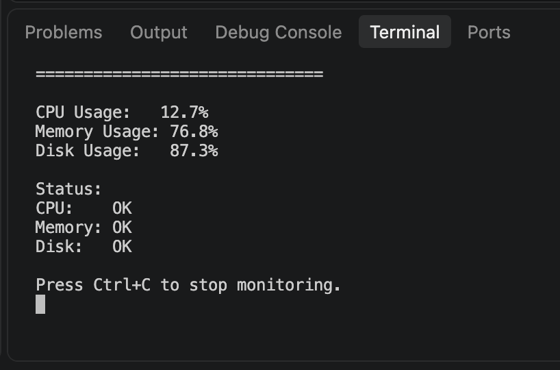

# TB System Resource Monitor
This programme is a Python command-line system resource monitor built with psutil, built to help you understand how your computer uses its resources. It displays CPU, memory, and disk usage, flags high usage, and identifies the processes using the most memory. You can also save timestamped snapshots to a CSV file for later review. 

## Features
- View CPU, memory and disk usage, including used and total capacity.
- Monitor live resource usage continuously with an updating terminal display.
- Diagnose whether resource threshold are acceptable or too high. 
- List the five processes using the most memory, with their names, process IDs, and memory percentages.
- Append resource snapshots to a CSV log without overwriting previous entries.
- View operating system, hostname, processor, and Python version information.
- Handle invalid menu input and return to the menu after stopping live monitoring.  

## Technologies
- Python 3.8 or later
- psutil for reading system resource and process information
- Python standard library: os, platform, socket, time, csv, and datetime

## Project Structure
main.py = 	Displays the menu and handles user input and feature selection.
monitor.py = Collects system data, checks thresholds, displays live updates, and ranks processes.
logger.py = Appends timestamped resource snapshots to a CSV file.
logs/.gitkeep = Keeps the logs directory in version control.
logs/snapshots.csv = Generated snapshot history; excluded from Git.
requirements.txt = Lists the external dependency, psutil.
.gitignore = Excludes generated logs, Python cache files, and local development files.
README.md = Documents installation, usage, and project details.

## Installation
git clone https://github.com/ReeceGroeneveld/system-resource-monitor.git
cd system-resource-monitor
python -m pip install -r requirements.txt

## How to Run
From the project directory, with the virtual environment activated, run:
python main.py

## Menu Options
Enter a number from 1–6 to choose a feature. After viewing a result, press Enter when prompted to return to the menu. During live monitoring, press Ctrl+C to stop monitoring and return to the menu.

1.	View Current System Status= Displays CPU, memory, and disk usage with any high-usage warnings.
2.	Start Live Monitor= Repeatedly updates resource percentages and their OK / HIGH statuses.
3.	View Top Processes= Shows up to five readable processes, sorted by memory usage from highest to lowest.
4.	Save Current Snapshot= Appends one timestamped resource reading to logs/snapshots.csv.
5.	View System Information= Displays the operating system and release, hostname, processor, and Python version.
6.	Exit= Closes the application.

## Screenshots / Demos

## Known Limitaions
- CPU usage is sampled over one second, so gathering a status reading takes about one second.
- Live monitoring waits two seconds after each display update, in addition to the sampling time.
- Disk usage measures storage capacity on the selected main volume, rather than disk read/write activity or every connected drive.
- Processes that have ended or cannot be accessed are skipped, so the process list may omit some entries.
- Memory accounting varies by operating system, so values may differ from other monitoring tools.
- Processor information may display Not available if the operating system does not provide it.
- Snapshots are saved manually. The program does not generate historical charts or automatically rotate log files.

## What I Learned
This project gave me practice dividing a Python application into modules with separate responsibilities. I used dictionaries and lists to organize system data, sorted processes by memory usage, and handled exceptions so unavailable processes or interrupted monitoring could be managed cleanly. I also practiced writing CSV files, building a menu with loops and conditionals, and using Git to track changes.